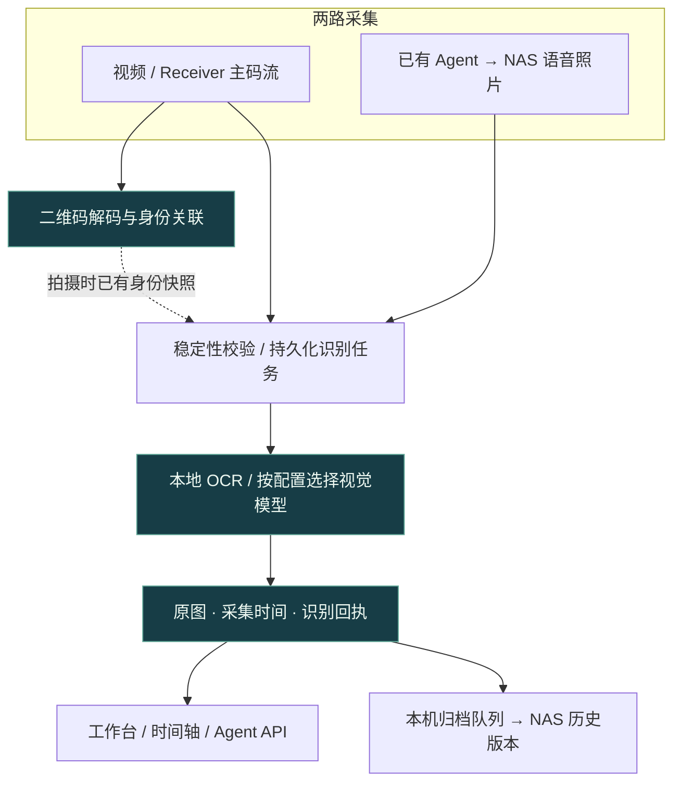

<a id="top"></a>

<div align="center">

<h1>
<picture>
  <source media="(max-width: 640px)" srcset="docs/assets/readme-hero-mobile.svg">
  
</picture>
</h1>

<p>视频扫码绑定 · 本地 GPU OCR · 语音照片读数 · 采集时间追溯</p>

<p>
  <a href="#quick-start"><strong>快速开始</strong></a> &nbsp; / &nbsp;
  <a href="#features"><strong>核心能力</strong></a> &nbsp; / &nbsp;
  <a href="AgentTools.md"><strong>Agent 接入</strong></a> &nbsp; / &nbsp;
  <a href="#documentation"><strong>文档导航</strong></a>
</p>

<p>
  
  
  
  
</p>

</div>

## 让读数回到现场

实验记录需要回答：**哪台仪器、谁在使用、何时采集、原图在哪里。** FieldRecognition 将视频扫码、面板识别与证据留存放进同一条链路，读数可追溯到原始画面和拍摄时的身份关联。

挂脖相机解出已登记的仪器码后建立绑定；视频稳定读数可自动留证；已有 Agent 写入 NAS 的语音照片也可独立识别。**没有有效绑定时，仪器身份保持空值。** 候选、人工校正和正式确认分别记录，不凭面板文字推断物理资产或操作。

<a id="features"></a>

## 核心能力

###  扫码确认仪器

真实解码场景与仪器码，支持多相机和同相机多仪器。保留命中帧、人员使用时段与绑定历史，异常释放或跨日后重新扫码。

###  两路采集，同一时间轴

视频稳定读数自动留证，已有语音照片从 NAS 导入。通过 `/trace` 按采集时间查看画面、来源与识别版本。

###  本地识别，模型常驻

GPU PaddleOCR 复用常驻模型，照片任务优先、模型串行；支持面板区域处理与手动选框，CPU 可用于独立便携环境。

###  按需接入视觉模型

默认本地识别优先，满足条件时尝试云端兜底；照片可配置视觉优先。保留原始回答与失败回执，无法读取时不补造数字。

###  复核、确认与版本追溯

逐张候选、连拍冲突与人工校正都有记录。重新识别生成新版本，原图、拍摄时归属和旧回执继续保留。

###  证据留存与 Agent 接入

原图、SHA-256、阶段时间与身份快照关联归档；NAS 恢复后队列继续重试。网页、HTTP API 与 Agent 工具共用业务规则。

<a id="workflow"></a>

## 在现场如何使用

| 步骤 | 使用者的动作 | 系统保留的依据 |
| :--- | :--- | :--- |
| **01 · 登记** | 登记仪器与相机成员，明确选择本次使用人。 | 仪器配置、人员资格与实际使用时段。 |
| **02 · 扫码** | 用挂脖相机对准已登记的仪器码；场景码可单独扫描。 | 实际解码内容、命中帧、时间及绑定关系。 |
| **03 · 采集** | 保持面板可见，或对已有 Agent 说“拍照”。 | 视频观测帧或 NAS 原始照片、采集时间及来源。 |
| **04 · 核对** | 在工作台查看读数；正式记录按草稿流程复核、确认。 | 逐张候选、冲突、人工校正及确认版本。 |
| **05 · 追溯** | 在时间轴或归档导航中打开原图和结果。 | 图像哈希、拍摄时归属、识别过程与历史回执。 |

视频默认在稳定读数变化时留证，读数不变时也按配置周期保存新观测；默认周期为 30 秒，须满足新鲜画面、稳定识别与资源条件。语音拍照由外部 Agent 完成，本项目只接收和识别已有照片。详细协议见 [两路采集时间追溯](docs/TwoStreamEvidence20260923.md)。

<details>
<summary><strong>绑定何时结束？三连拍和视觉模型如何处理？</strong></summary>

- **绑定生命周期：** 同会话重复扫码沿用有效关系；设备离线、采集服务异常、Receiver 接入会话变化或北京时间零点会结束旧关系。恢复后必须重新扫码，历史证据保留。
- **三连拍：** 默认按明确的 `PhotoReceipt.json` 回执归组。只有已核对来源约定的部署才启用 `directory_triplet`；同一秒或文件后缀不能单独证明连拍关系，历史照片不强行重新归组。
- **默认识别：** 本地 OCR 先处理；单张任务运行 5 秒仍无完整数字候选时，满足可用性、串行槽位与冷却条件才尝试视觉兜底。**5 秒是触发条件，不是出结果时延承诺。**
- **照片视觉优先：** 可配置 `FIELD_VISION_PHOTO_MODE=primary`。无绑定照片直接产生待复核候选；绑定照片先定位授权面板。调用失败可尝试本地 OCR，不能据此制造仪器身份。

参见 [自动解绑](docs/AutomaticBindingRelease20260921.md)、[视觉主识别](docs/NianfengVision20260925.md) 和 [Agent 接口](AgentTools.md)。

</details>

<a id="quick-start"></a>

## 快速开始

### 已有本机部署

打开应用菜单中的 **“现场识别”** 或 [本机工作台](http://127.0.0.1:8188/)，登记并选择实验员后开启自动运行。关闭网页后后台服务继续运行。操作说明见 [本机自动运行](docs/本机自动运行.md)。

### 全新隔离环境

下面使用 CPU 依赖运行单进程体验，要求已安装 `uv`，且端口 8188 空闲。已有部署请使用其工作台；常驻多服务部署见 [托管运行说明](docs/ProductionRuntime.md)。

```bash
git clone https://github.com/kealan-Jun/FieldRecognition.git
cd FieldRecognition

uv python install 3.11.15
uv venv --python 3.11.15 .venv
uv pip install --python .venv/bin/python -r Requirements.lock.txt

FIELD_OCR_DEVICE=cpu OMP_NUM_THREADS=2 OPENBLAS_NUM_THREADS=2 \
  .venv/bin/python -m uvicorn app:app --host 127.0.0.1 --port 8188
```

打开 [http://127.0.0.1:8188](http://127.0.0.1:8188)。尚未接入 Receiver 时，可使用兼容照片上传接口和 [二维码样张](static/labels/) 体验基础流程；现场主采集方式仍是视频与外部语音照片。

本机部署使用 **RTX 3090 Ti / `gpu:0`**。新建适配的 GPU 环境使用 [Requirements.gpu.lock.txt](Requirements.gpu.lock.txt) 并选择 `FIELD_OCR_DEVICE=gpu:0`，平台要求见 [GPU 部署](docs/GPU部署.md)。模型权重不随 Git 分发；无完整本地缓存时可能下载，显式指定的模型目录不完整会报错。

<details>
<summary><strong>接入配置：相机、NAS 与可选视觉模型</strong></summary>

模板见 [.env.example](.env.example)。手动运行需要设置环境变量，程序不会自动读取 `.env`；托管服务通过环境文件加载配置。凭证只放环境变量或未跟踪的本地文件。

| 配置 | 用途 |
| :--- | :--- |
| `FIELD_OCR_DEVICE` | `cpu` 或 `gpu:0`；GPU 不可用时明确报错。 |
| `FIELD_RECEIVER_URL`、`FIELD_CAMERA_ID` | Receiver 地址与相机标识，主码流需支持 GWHP 协议。 |
| `FIELD_SAVED_PHOTO_ROOT`、`FIELD_SAVED_PHOTO_WATCH_ENABLED=1` | 监控已挂载的语音照片目录，不要求先绑定。 |
| `FIELD_SAVED_PHOTO_TIMEZONE` | 照片文件名时间的时区，默认 `Asia/Shanghai`。 |
| `FIELD_ARCHIVE_ENABLED`、`FIELD_ARCHIVE_ROOT`、`FIELD_ARCHIVE_MOUNT` | 独立 NAS 归档目标及挂载点，数据库保留在本机。 |
| `FIELD_VIDEO_EVIDENCE_INTERVAL_SECONDS` | 稳定视频读数周期留证间隔，默认 30 秒。 |
| `FIELD_VOICE_PHOTO_BATCH_MODE` | 默认 `receipt_only`；明确核对来源约定后才选 `directory_triplet`。 |
| `DASHSCOPE_API_KEY`、`FIELD_ALIYUN_FALLBACK_ENABLED=1` | 默认阿里云视觉兜底配置；调用受条件和冷却约束。 |
| `FIELD_VISION_PROVIDER`、`FIELD_VISION_ENABLED`、`FIELD_VISION_PHOTO_MODE` | 可选视觉提供方与照片识别模式，详见 [视觉配置](docs/NianfengVision20260925.md)。 |

语音照片按以下来源布局接收，日期与文件名时间需要匹配；支持 `.jpg`、`.jpeg`、`.png`：

```text
voice_photos/
└── <camera_id>/
    └── YYYY-MM-DD/
        └── HH-MM-SS/
            └── YYYYMMDD_HHMMSS[_序号].jpg
```

照片稳定性、时间来源、去重与批次声明分别校验。详见 [技术方案](技术方案.md) 和 [NAS 留存指南](docs/NAS文件夹与留存指南.md)。

</details>

<a id="architecture"></a>

## 系统架构

视频与语音照片共享身份快照、任务队列和归档，但各自保留采集来源。在托管模式中，API、相机监控、OCR 和归档分别运行；NAS 提供文件共享，识别服务运行在本机。



识别路径由配置和任务条件决定；任务跳过模型或无法读清时仍保留对应回执。

| 层次 | 主要技术 | 职责 |
| :--- | :--- | :--- |
| **采集与身份** | PyAV · ZXing-C++ · OpenCV | 视频解码、二维码识别、采集会话与绑定生命周期。 |
| **任务与读数** | FastAPI · SQLite · PaddleOCR | 持久化调度、面板识别、候选校验与版本管理。 |
| **视觉模型** | HTTPX · 可配置视觉接口 | 条件兜底或照片优先识别，保留原始回答与失败依据。 |
| **交互与留存** | HTML / JavaScript · HTTP JSON · NAS | 工作台、时间追溯、Agent 接入、原图校验与队列补传。 |

<details>
<summary><strong>仓库结构</strong></summary>

```text
FieldRecognition/
├── app.py                           # HTTP 服务入口
├── receiver.py / live_scan.py        # 视频接入、扫码与采集会话
├── scene_binding.py                 # 场景和仪器绑定规则
├── photo_watch.py / saved_photo.py   # NAS 照片发现、导入与去重
├── panel_readout.py / panel_regions.py # 面板读数与候选处理
├── photo_measurements.py            # 连拍草稿、复核与确认
├── evidence_timeline.py             # 两路采集时间追溯
├── archive_store.py / archive_events.py # 归档队列与事件文件
├── aliyun_vision.py                  # 可配置视觉调用与结果校验
├── agent_tools.py / agent_client.py  # Agent 工具与 Python 适配器
├── static/                          # 工作台、时间轴与二维码样张
├── deployment/                      # 托管服务模板
├── schemas/                         # 业务 JSON 契约
├── tests/                           # 临时数据自动测试
├── docs/                            # 部署、验证记录与流程图
├── .env.example                     # 配置模板
├── Requirements*.lock.txt           # CPU / GPU 锁定依赖
├── AgentTools.md                    # 接入接口与调用示例
└── 技术方案.md                       # 实现机制与边界
```

`Data/`、`Verification/`、`VerificationData/`、`output/`、`tmp/` 为本地运行或验证材料；虚拟环境、模型权重、日志与凭证不纳入 Git。

</details>

<a id="documentation"></a>

## 文档导航

| 我想了解… | 从这里开始 |
| :--- | :--- |
| **系统如何实现** | [技术方案](技术方案.md) · [多二维码与实时视频 OCR](docs/多二维码与实时视频OCR.md) |
| **让 Agent 获取读数** | [工具参数、发现接口与 Python 示例](AgentTools.md) |
| **安装与常驻运行** | [GPU 部署](docs/GPU部署.md) · [托管运行](docs/ProductionRuntime.md) · [工作台推理连接](docs/工作台推理连接与恢复.md) |
| **使用与身份关联** | [本机自动运行](docs/本机自动运行.md) · [多人使用与绑定快照](docs/FieldRepair20260920.md) · [自动解绑](docs/AutomaticBindingRelease20260921.md) |
| **视频与语音照片采集** | [两路时间追溯](docs/TwoStreamEvidence20260923.md) · [照片视觉优先](docs/NianfengVision20260925.md) |
| **查找照片、结果与正式字段** | [NAS 留存指南](docs/NAS文件夹与留存指南.md) · [六字段 JSON 契约](schemas/InstrumentMeasurement.schema.json) |
| **升级、迁移与恢复** | [运行可靠性与升级入口](docs/RuntimeReliability.md#升级入口) · [数据库迁移](docs/BindingMigration.md) |
| **评估验证证据与近期进展** | [时延修订与验收](docs/PublicationLatency20261008.md) · [历史运行验证](docs/运行与验证记录.md) · [项目进展](docs/ProjectHistory.md) |

<a id="evaluation"></a>

## 验证与边界

这里的状态说明**证据覆盖范围**。模型置信分数、任务完成、文件存在或服务健康响应，都不能直接当作真实仪器准确率。

| 状态 | 当前可依据的检查 | 尚不能据此推断 |
| :--- | :--- | :--- |
| **`PROVEN`** | 已记录回归覆盖的绑定、去重、租约、版本与归档契约；指定样张的真实 GPU 调用与复用；指定验证批次的文件可读和哈希一致性。 | 未覆盖的现场环境、整条采集链路和长期性能。 |
| **`PARTIAL_EVIDENCE`** | 已有视频接入、NAS 来源解析及有限历史照片回放；隔离目录中观察到结果发布时延收敛。 | 代表性生产负载、设备服务停启后的完整重新绑定闭环。 |
| **`NOT_PROVEN`** | 仍待人工真值样本和现场验收。 | 真实仪器准确率、长期稳定性、产品时延阈值及运行代码无损不中断升级。 |

**近期版本状态：** 2026-10-08 的归档时延修订完成隔离回归与有限 NAS 回放，运行变更仍待部署。十组实测、后续候选与追加附测的版本及失败记录分别保留，不能混用结论。详见 [时延验收记录](docs/PublicationLatency20261008.md)。

二维码是未签名的身份码，不是防复制凭证。Receiver 会话变化也可能来自设备重连或 Receiver 重启；精确判断设备进程启动仍需要上游实例标识。面板定位、反光、遮挡、单位冲突和数字歧义仍需核对，照片文件名时间不等于独立校时的硬件时间。

<details>
<summary><strong>运行自动测试与迭代约束</strong></summary>

在本项目独立环境中运行，测试使用临时数据：

```bash
env -u FIELD_RECEIVER_URL -u FIELD_CAMERA_SNAPSHOT_URL \
  OMP_NUM_THREADS=2 OPENBLAS_NUM_THREADS=2 \
  .venv/bin/python -m pytest -q tests
```

开发与验证在独立工作区完成。正常使用期间不因迭代停止 API、相机、OCR 或归档服务；检查已测试提交使用 `scripts/upgrade_runtime.py --revision <SHA>`。当前共享源码部署尚无已验证的运行代码无缝替换机制，运行变更保持待部署，规则以 [升级入口](docs/RuntimeReliability.md#升级入口) 为准。

后续验收重点为现场连续扫码与故障后重新绑定、真实语音拍照闭环、不同仪器与拍摄条件的人工真值评测，以及生产负载下的结果首读和长期时延分布。

</details>

---

<p align="center">
  <sub><strong>FieldRecognition</strong> · 让每次现场识别，都能回到它的依据。</sub><br>
  <sub><a href="#top">返回顶部 ↑</a></sub>
</p>
