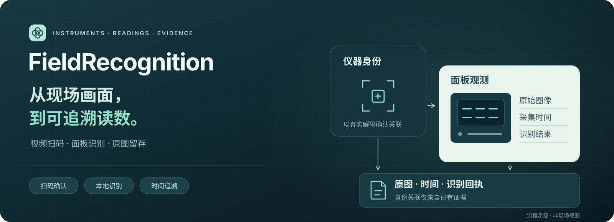
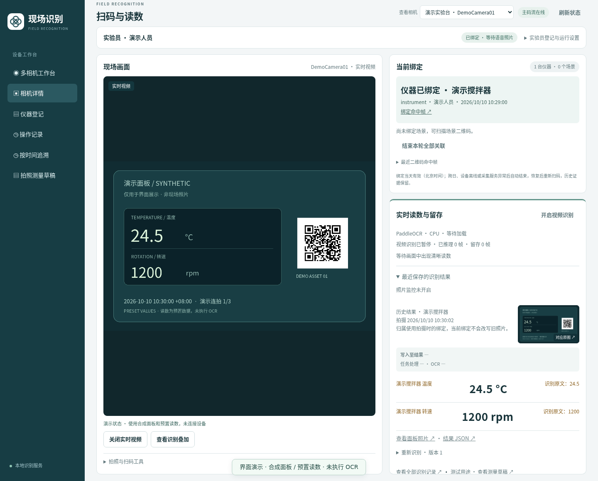
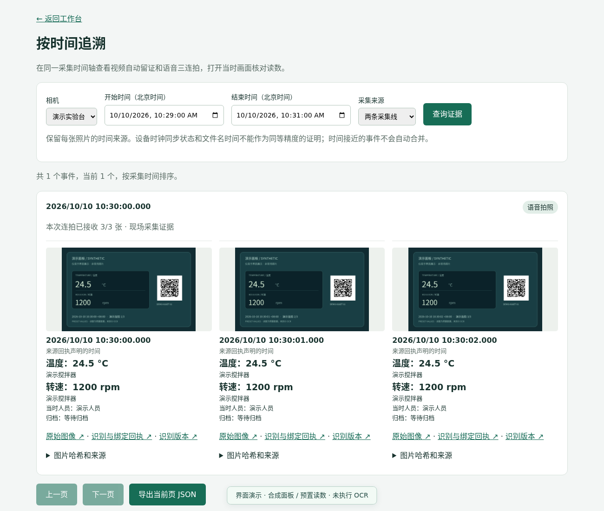
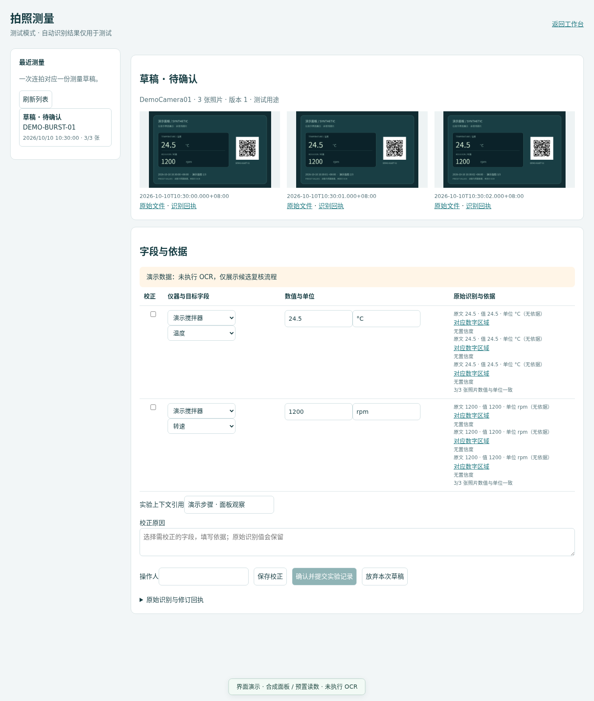
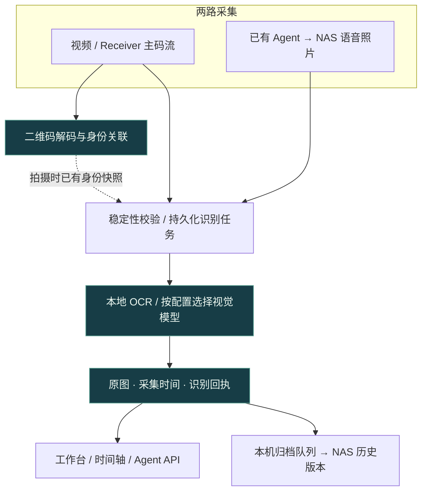

<a id="top"></a>

<div align="center">

<h1>
<picture>
  <source media="(max-width: 640px)" srcset="docs/assets/readme-hero-mobile.svg">
  
</picture>
</h1>

<p>视频扫码绑定 · 本地 GPU OCR · 语音照片读数 · 采集时间追溯</p>

<p>
  <a href="#showcase"><strong>界面预览</strong></a> &nbsp; / &nbsp;
  <a href="#quick-start"><strong>快速开始</strong></a> &nbsp; / &nbsp;
  <a href="AgentTools.md"><strong>Agent 接入</strong></a> &nbsp; / &nbsp;
  <a href="#documentation"><strong>文档导航</strong></a>
</p>

<p>
  
  
  
  
</p>

</div>

## 让读数回到现场

**哪台仪器、谁在使用、何时采集、原图在哪里。** FieldRecognition 将扫码绑定、视频自动留证与已有语音照片识别放进同一条证据链。每条结果保留采集时间、拍摄时归属与识别版本；**没有有效绑定时，不推断仪器归属；照片实际解码得到的二维码身份单独保留。**

<a id="showcase"></a>

## 看见画面，也看见依据

在同一个工作台查看画面、当前绑定与最近读数，打开原图核对结果。

<picture>
  <source media="(max-width: 640px)" srcset="docs/assets/readme-demo/workbench-mobile.png">
  
</picture>

<sub>项目实际界面 · 合成面板与预置数据 · 未连接真实相机、GPU 或 NAS。截图展示交互方式，不代表现场识别准确率。</sub>

<details>
<summary><strong>继续查看：证据时间轴与测量复核</strong></summary>

### 按采集时间找回画面

每张照片分别保留时间来源、当时人员与回执入口。以下演示批次预置三张合成图，时间为来源声明，归档保持待处理。



### 对照原图，逐项核对候选

草稿页并列展示照片、字段与逐张候选依据。演示使用测试模式，预置数值尚未经过 OCR 或人工真值验证。



</details>

### 一个可打开的完整示例

| 输入 | 候选 | 回到依据 |
| :--- | :--- | :--- |
| [合成面板原图](docs/assets/readme-demo/input-1.png)，另附两张演示连拍。 | 预置 **24.5 °C / 1200 rpm**，在测试草稿中复核。 | [完整演示回执](docs/assets/readme-demo/receipt.json)：原图哈希、声明时间、演示绑定与候选来源。 |

回执明确记录 `demo_only=true`、`candidate_source=preset_fixture`、`ocr_executed=false`。合成二维码经过离线解码；绑定、读数与连拍关系为演示预置，真实仪器准确率为 **`NOT_PROVEN`**。素材来源与核对方法见 [界面演示说明](docs/ReadmeShowcase.md)。

<a id="features"></a>

## 核心能力

###  扫码与使用时段

多相机、多仪器通过实际二维码解码关联身份；保留命中帧与人员时段，异常释放或跨日后重新扫码。

###  两路采集，同一时间轴

视频稳定读数与已有 NAS 语音照片分别留证；通过 `/trace` 查看采集时间、来源与识别版本。

###  本地 OCR 与可选视觉模型

PaddleOCR 支持 GPU / CPU、常驻模型与面板区域处理；视觉模型按配置和条件调用，无法读取时不补造数字。

###  复核、版本与证据归档

候选、校正与正式确认分别记录，重新识别保留旧版本；原图、哈希与身份快照关联归档，网页和 Agent 共用业务规则。

<a id="workflow"></a>

## 在现场如何使用

| 步骤 | 使用者的动作 | 系统保留的依据 |
| :--- | :--- | :--- |
| **01 · 登记与扫码** | 登记仪器与相机成员，选择本次使用人，再扫描仪器码；场景码可单独扫描。 | 人员时段、实际解码内容、命中帧与绑定关系。 |
| **02 · 采集** | 保持面板可见，或对已有 Agent 说“拍照”。 | 视频观测帧或 NAS 原始照片、采集时间与来源。 |
| **03 · 复核与追溯** | 核对候选，按草稿流程确认正式记录；随时打开原图和历史版本。 | 逐张依据、冲突、人工校正、图像哈希与回执。 |

语音拍照由外部 Agent 完成，本项目接收和识别已有照片。详细协议见 [两路采集时间追溯](docs/TwoStreamEvidence20260923.md)。

<details>
<summary><strong>绑定何时结束？三连拍和视觉模型如何处理？</strong></summary>

- **视频留证：** 稳定读数变化时保存，不变时按配置周期保存新观测，默认 30 秒；须满足新鲜画面、稳定识别与资源条件。
- **绑定生命周期：** 同会话重复扫码沿用有效关系；[短断流恢复规则](docs/BindingReconnect20261014.md)为传输异常保留 30 秒恢复窗口，恢复在线状态与新画面后延续原绑定；超时、明确设备重启、采集进程异常或北京时间零点仍结束旧关系。历史证据保留，断流空档的照片归属待核实。
- **三连拍：** 默认按明确的 `PhotoReceipt.json` 回执归组。只有已核对来源约定的部署才启用 `directory_triplet`；同一秒或文件后缀不能单独证明连拍关系，历史照片不强行重新归组。
- **默认识别：** 本地 OCR 先处理；单张任务运行 5 秒仍无完整数字候选时，满足可用性、串行槽位与冷却条件才尝试视觉兜底。**5 秒是触发条件，不是出结果时延承诺。**
- **照片视觉优先：** 可配置 `FIELD_VISION_PHOTO_MODE=primary`。无绑定照片直接产生待复核候选；绑定照片先定位授权面板。调用失败可尝试本地 OCR，不能据此制造仪器身份。
- **照片并行初读与复核：** 配置 `FIELD_VISION_PHOTO_MODE=parallel`，本地与云端读取同一照片；绑定照片共用授权面板定位。初读先展示与归档，复核更新同一任务和结果路径，保留旧回执；详见 [并行照片识别](docs/ParallelPhotoReview20261015.md) 和 [误报保护及本机上线记录](docs/CloudReviewRepair20261015.md)。

参见 [自动解绑](docs/AutomaticBindingRelease20260921.md)、[视觉主识别](docs/NianfengVision20260925.md) 和 [Agent 接口](AgentTools.md)。

</details>

<a id="quick-start"></a>

## 快速开始

### 已有本机部署

打开应用菜单中的 **“现场识别”** 或 [本机工作台](http://127.0.0.1:8188/)，登记并选择实验员后开启自动运行。关闭网页后后台服务继续运行。操作说明见 [本机自动运行](docs/本机自动运行.md)。

### 全新隔离环境

下面在 Linux x86_64、Python 3.11 环境中使用 CPU 依赖运行单进程体验，要求先按 [uv 官方安装说明](https://docs.astral.sh/uv/getting-started/installation/) 安装 `uv`，且端口 18188 空闲。其他平台未在当前 CI 中验证。已有部署请使用其工作台；常驻多服务部署见 [托管运行说明](docs/ProductionRuntime.md)。

```bash
git clone https://github.com/kealan-Jun/FieldRecognition.git
cd FieldRecognition

uv python install 3.11.15
uv venv --python 3.11.15 .venv
uv pip install --python .venv/bin/python -r Requirements.lock.txt

env -i PATH="$PATH" HOME="$HOME" LANG=C.UTF-8 \
  FIELD_DEMO_DATA="$PWD/tmp/CpuUpload" FIELD_CAMERA_ID=SampleUploadCamera \
  FIELD_RECORD_MODE=test FIELD_REGISTRY_POLICY=sample FIELD_OCR_DEVICE=cpu \
  OMP_NUM_THREADS=2 OPENBLAS_NUM_THREADS=2 \
  .venv/bin/python -m field_recognition --host 127.0.0.1 --port 18188
```

打开 [http://127.0.0.1:18188](http://127.0.0.1:18188)。此体验使用忽略的 `tmp/CpuUpload/` 保存本地数据，显式导入样例二维码，不继承 Receiver、NAS、云端或生产数据库配置。退出终端进程即可结束体验。现场主采集方式仍是视频与外部语音照片。

在另一个终端的仓库根目录上传一张随仓库提供的二维码样张；这一步只解码和保存照片，不运行 OCR：

```bash
.venv/bin/python - <<'PY'
import base64
from pathlib import Path
from field_recognition.api.agent_client import FieldTools

tools = FieldTools('http://127.0.0.1:18188', camera_id='SampleUploadCamera')
scan = tools.call('scan_photo', {
    'camera_id': 'SampleUploadCamera',
    'image_base64': base64.b64encode(Path('static/labels/InstrumentA.png').read_bytes()).decode(),
})
print(scan['capture_id'], scan['matches'])
PY
```

照片上传不自动建立绑定。要体验面板 OCR，可上传自己的清晰 JPEG/PNG，按 [CPU 照片识别步骤](docs/QuickStart.md#cpu-照片识别) 提交并查询同一任务。仓库样例身份仅用于体验；正式仪器需 [导入自有注册表](docs/ProductionRuntime.md#owned-registries)，再真实扫码。

CPU 是默认推理设备。新建适配的 GPU 环境使用 [Requirements.gpu.lock.txt](Requirements.gpu.lock.txt) 并选择 `FIELD_OCR_DEVICE=gpu:0`，平台要求见 [GPU 部署](docs/GPU部署.md)。模型权重不随 Git 分发；无完整本地缓存时可能下载，显式指定的模型目录不完整会报错。

<details>
<summary><strong>接入配置：相机、NAS 与可选视觉模型</strong></summary>

模板见 [.env.example](.env.example)。手动启动默认只读取环境变量；需要配置文件时显式运行 `.venv/bin/python -m field_recognition --env-file .env`，不会自动搜索 `.env`。已有环境变量优先于文件，`--host`、`--port` 再覆盖监听地址；文件只接受注释与 `KEY=value`，不执行 shell 或变量展开。托管服务通过环境文件加载配置。凭证只放环境变量或未跟踪的本地文件。

| 配置 | 用途 |
| :--- | :--- |
| `FIELD_OCR_DEVICE` | `cpu` 或 `gpu:0`；GPU 不可用时明确报错。 |
| `FIELD_RECEIVER_URL`、`FIELD_CAMERA_ID` | Receiver 地址与精确相机标识；配置 Receiver 或快照 URL 时必须同时指定相机，主码流需支持 GWHP 协议。 |
| `FIELD_HOST`、`FIELD_PORT` | 默认 `127.0.0.1:8188`，首次体验显式使用 18188。 |
| `FIELD_REGISTRY_POLICY` | `auto` 在 test 模式导入样例、production 模式不导入；`sample` 显式选用样例；`none` 跳过导入，不删除既有登记。 |
| `FIELD_SAVED_PHOTO_ROOT`、`FIELD_SAVED_PHOTO_WATCH_ENABLED=1` | 监控已挂载的语音照片目录，不要求先绑定。 |
| `FIELD_SAVED_PHOTO_TIMEZONE` | 照片文件名时间的时区，默认 `Asia/Shanghai`。 |
| `FIELD_ARCHIVE_ENABLED`、`FIELD_ARCHIVE_ROOT`、`FIELD_ARCHIVE_MOUNT` | 独立 NAS 归档目标及挂载点，数据库保留在本机。 |
| `FIELD_VIDEO_EVIDENCE_INTERVAL_SECONDS` | 稳定视频读数周期留证间隔，默认 30 秒。 |
| `FIELD_VOICE_PHOTO_BATCH_MODE` | 默认 `receipt_only`；明确核对来源约定后才选 `directory_triplet`。 |
| `DASHSCOPE_API_KEY`、`FIELD_ALIYUN_FALLBACK_ENABLED=1` | 默认阿里云视觉兜底配置；调用受条件和冷却约束。 |
| `FIELD_VISION_PROVIDER`、`FIELD_VISION_ENABLED`、`FIELD_VISION_PHOTO_MODE` | 可选视觉提供方与照片识别模式，详见 [视觉配置](docs/NianfengVision20260925.md)。 |

语音照片按以下来源布局接收，日期与文件名时间需要匹配；支持 `.jpg`、`.jpeg`、`.png`：

```text
voice_photos/
└── <camera_id>/
    └── YYYY-MM-DD/
        └── HH-MM-SS/
            └── YYYYMMDD_HHMMSS[_序号].jpg
```

照片稳定性、时间来源、去重与批次声明分别校验。详见 [技术方案](docs/Architecture.md) 和 [NAS 留存指南](docs/NAS文件夹与留存指南.md)。

</details>

<a id="architecture"></a>

## 系统架构

视频与语音照片共享身份快照、任务队列和归档，但各自保留采集来源。在托管模式中，API、相机监控、OCR 和归档分别运行；NAS 提供文件共享，识别服务运行在本机。



识别路径由配置和任务条件决定；任务跳过模型或无法读清时仍保留对应回执。

<details>
<summary><strong>技术组成与仓库结构</strong></summary>

| 层次 | 主要技术 | 职责 |
| :--- | :--- | :--- |
| **采集与身份** | PyAV · ZXing-C++ · OpenCV | 视频解码、二维码识别、采集会话与绑定生命周期。 |
| **任务与读数** | FastAPI · SQLite · PaddleOCR | 持久化调度、面板识别、候选校验与版本管理。 |
| **视觉模型** | HTTPX · 可配置视觉接口 | 条件兜底或照片优先识别，保留原始回答与失败依据。 |
| **交互与留存** | HTML / JavaScript · HTTP JSON · NAS | 工作台、时间追溯、Agent 接入、原图校验与队列补传。 |

```text
FieldRecognition/
├── field_recognition/               # 可导入的业务包
│   ├── api/                         # 应用工厂、HTTP 与 Agent 适配
│   ├── bindings/                    # 二维码身份、使用时段与交接
│   ├── capture/                     # Receiver、扫码与照片导入
│   ├── recognition/                 # OCR、面板与视觉调用
│   ├── measurements/                # 读数规则、草稿与证据事务
│   ├── archive/                     # 归档队列、事件与历史索引
│   └── runtime/                     # 配置、数据库与独立 worker
├── app.py / *_worker.py              # 兼容服务启动入口
├── agent_client.py                  # 兼容 Python 客户端导入
├── static/                          # 页面、共享工具与工作台控制器
├── scripts/                         # 运维、迁移与离线验证工具
├── deployment/                      # 托管服务模板
├── schemas/                         # 业务 JSON 契约
├── tests/                           # 按业务分组；support 共用测试夹具
├── docs/                            # 使用、架构与维护文档
│   └── history/                     # 保留原结论的历史交付记录
├── pyproject.toml                   # 开发与静态检查配置
├── Requirements*.lock.txt           # CPU / GPU 锁定依赖
├── .env.example                     # 配置模板
├── AgentTools.md                    # Agent 接口与调用示例
└── AGENTS.md                        # 项目维护与技能适用规则
```

`Data/`、`Verification/`、`VerificationData/`、`output/`、`tmp/` 为本地运行或验证材料；虚拟环境、模型权重、日志与凭证不纳入 Git。

</details>

<a id="documentation"></a>

## 文档导航

| 我想了解… | 从这里开始 |
| :--- | :--- |
| **系统实现与安装** | [技术方案](docs/Architecture.md) · [GPU 部署](docs/GPU部署.md) · [托管运行](docs/ProductionRuntime.md) |
| **让 Agent 获取读数** | [工具参数、发现接口与 Python 示例](AgentTools.md) |
| **采集与身份关联** | [自动运行](docs/本机自动运行.md) · [绑定快照](docs/FieldRepair20260920.md) · [自动解绑](docs/AutomaticBindingRelease20260921.md) · [短断流恢复](docs/BindingReconnect20261014.md) · [两路采集](docs/TwoStreamEvidence20260923.md) |
| **照片、结果与复核** | [NAS 留存指南](docs/NAS文件夹与留存指南.md) · [六字段契约](schemas/InstrumentMeasurement.schema.json) · [照片方向恢复](docs/PhotoOrientationRecovery.md) · [视觉配置](docs/NianfengVision20260925.md) · [界面演示](docs/ReadmeShowcase.md) |
| **维护与目录** | [文档索引](docs/README.md) · [代码结构](docs/CodeStructure.md) · [Agent 指南](AGENTS.md) · [贡献指南](CONTRIBUTING.md) · [安全说明](SECURITY.md) |
| **验证与升级** | [升级入口](docs/RuntimeReliability.md#升级入口) · [数据库迁移](docs/BindingMigration.md) · [时延验收](docs/PublicationLatency20261008.md) · [项目进展](docs/ProjectHistory.md) |

<a id="evaluation"></a>

## 验证与边界

这里的状态说明**证据覆盖范围**。模型置信分数、任务完成、文件存在或服务健康响应，都不能直接当作真实仪器准确率。

| 状态 | 当前可依据的检查 | 尚不能据此推断 |
| :--- | :--- | :--- |
| **`PROVEN`** | 已记录回归覆盖的绑定、去重、租约、版本与归档契约；指定样张的真实 GPU 调用与复用；指定验证批次的文件可读和哈希一致性。 | 未覆盖的现场环境、整条采集链路和长期性能。 |
| **`PARTIAL_EVIDENCE`** | 已有视频接入、NAS 来源解析及有限历史照片回放；隔离目录中观察到结果发布时延收敛。 | 代表性生产负载、设备服务停启后的完整重新绑定闭环。 |
| **`NOT_PROVEN`** | 仍待人工真值样本和现场验收。 | 真实仪器准确率、长期稳定性、产品时延阈值及运行代码无损不中断升级。 |

运行变更保持待部署；当前共享源码部署尚无已验证的运行代码无缝替换机制。验证记录与现场表现须分别评估。

<details>
<summary><strong>验证细节、自动测试与迭代约束</strong></summary>

2026-10-08 的归档时延修订完成隔离回归与有限 NAS 回放，运行变更仍待部署。十组实测、后续候选与追加附测的版本及失败记录分别保留，不能混用结论。详见 [时延验收记录](docs/PublicationLatency20261008.md) 与 [历史运行验证](docs/运行与验证记录.md)。

二维码是未签名的身份码，不是防复制凭证。Receiver 会话变化也可能来自设备重连或 Receiver 重启；精确判断设备进程启动仍需要上游实例标识。面板定位、反光、遮挡、单位冲突和数字歧义仍需核对，照片文件名时间不等于独立校时的硬件时间。

在本项目独立环境中运行，测试使用临时数据：

```bash
env -u FIELD_RECEIVER_URL -u FIELD_CAMERA_SNAPSHOT_URL \
  OMP_NUM_THREADS=2 OPENBLAS_NUM_THREADS=2 \
  .venv/bin/python -m pytest -q tests
```

开发与验证在独立工作区完成。正常使用期间不因迭代停止 API、相机、OCR 或归档服务；检查已测试提交使用 `scripts/upgrade_runtime.py --revision <SHA>`。当前共享源码部署尚无已验证的运行代码无缝替换机制，运行变更保持待部署，规则以 [升级入口](docs/RuntimeReliability.md#升级入口) 为准。

后续验收重点为现场连续扫码与故障后重新绑定、真实语音拍照闭环、不同仪器与拍摄条件的人工真值评测，以及生产负载下的结果首读和长期时延分布。

</details>

仓库暂未附带 `LICENSE`，许可由所有者另行决定。一般问题与改进建议按 [贡献指南](CONTRIBUTING.md) 提交；敏感安全问题按 [安全说明](SECURITY.md) 处理。

---

<p align="center">
  <sub><strong>FieldRecognition</strong> · 让每次现场识别，都能回到它的依据。</sub><br>
  <sub><a href="#top">返回顶部 ↑</a></sub>
</p>
